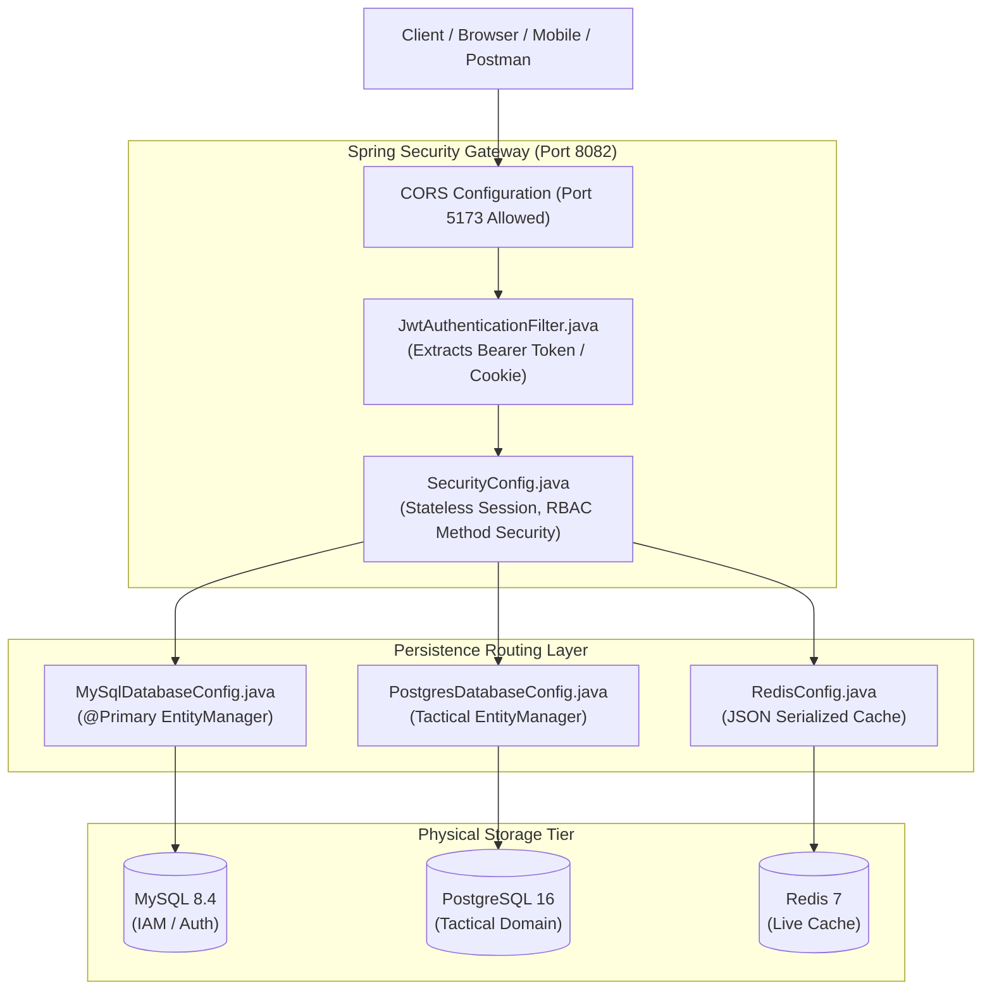
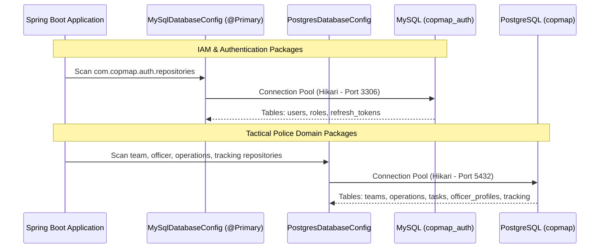
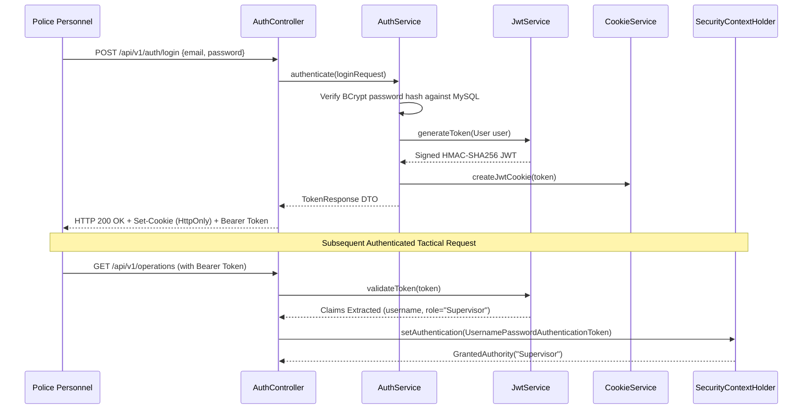
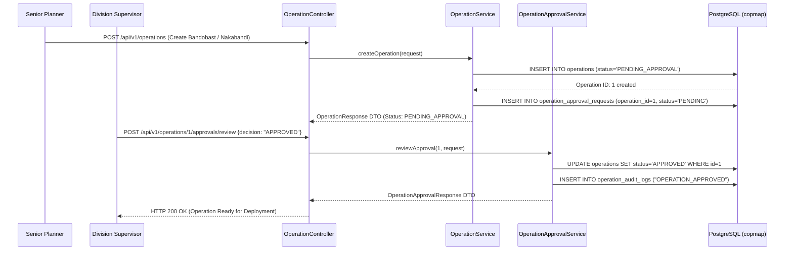
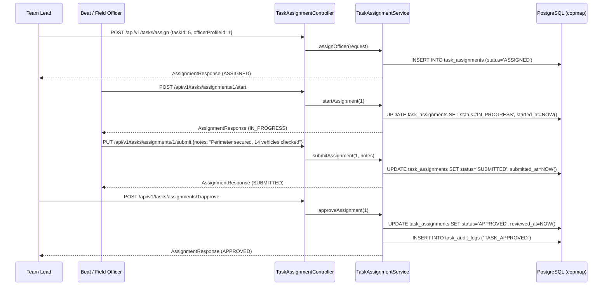
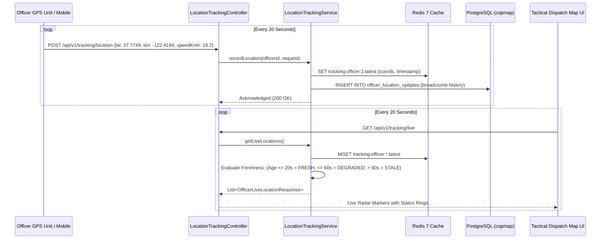
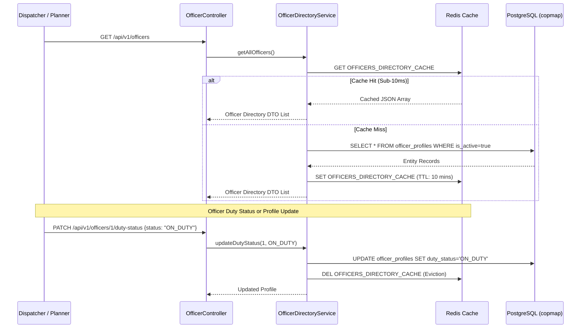

# CopMap (CMP) — Tactical Police Command & Operations Platform

> **Official Law Enforcement Operations System**  
> A mission-critical command, control, and coordination platform for police departments. Designed for real-time 20-second GPS telemetry tracking, automated Bandobast and Nakabandi perimeter management, strict 5-tier chain of command workflows, Redis-cached officer directory search, dual-database physical isolation (MySQL + PostgreSQL), and court-admissible tactical PDF dossier generation.

---

## Table of Contents

1. [Executive Summary & System Architecture](#1-executive-summary--system-architecture)
2. [End-to-End System Flows (Mermaid Diagrams)](#2-end-to-end-system-flows)
   - [2.1 High-Level Architecture & Request Flow](#21-high-level-architecture--request-flow)
   - [2.2 Dual-Database Isolation & JPA Routing Flow](#22-dual-database-isolation--jpa-routing-flow)
   - [2.3 Security, JWT Authentication & RBAC Filter Flow](#23-security-jwt-authentication--rbac-filter-flow)
   - [2.4 Tactical Operation & Cross-Team Approval Workflow](#24-tactical-operation--cross-team-approval-workflow)
   - [2.5 Tactical Task & Duty Lifecycle Flow](#25-tactical-task--duty-lifecycle-flow)
   - [2.6 20-Second Real-Time GPS Telemetry & Freshness Engine Flow](#26-20-second-real-time-gps-telemetry--freshness-engine-flow)
   - [2.7 Redis Officer Directory Caching & Invalidation Flow](#27-redis-officer-directory-caching--invalidation-flow)
3. [Folder Structure & Component Breakdown](#3-folder-structure--component-breakdown)
   - [3.1 Infrastructure & Database Configuration (`config/`)](#31-infrastructure--database-configuration-config)
   - [3.2 Identity, RBAC & Authentication (`auth/`)](#32-identity-rbac--authentication-auth)
   - [3.3 Tactical Teams & Rostering (`team/`)](#33-tactical-teams--rostering-team)
   - [3.4 Officer Profiles & Tactical Tasks (`officer/`)](#34-officer-profiles--tactical-tasks-officer)
   - [3.5 Tactical Operations & Approvals (`operations/common/`)](#35-tactical-operations--approvals-operationscommon)
   - [3.6 Real-Time GPS Telemetry (`tracking/`)](#36-real-time-gps-telemetry-tracking)
   - [3.7 Error Handling & Fault Envelope (`dtos/` & `exceptions/`)](#37-error-handling--fault-envelope-dtos--exceptions)
   - [3.8 Tactical Command Frontend (`frontend/`)](#38-tactical-command-frontend-frontend)
   - [3.9 Automated Postman Test Harness (`postman/`)](#39-automated-postman-test-harness-postman)
4. [Chain of Command & Role Hierarchy](#4-chain-of-command--role-hierarchy)
5. [Court-Admissible Tactical PDF Dossier Engine](#5-court-admissible-tactical-pdf-dossier-engine)
6. [Complete REST API Reference](#6-complete-rest-api-reference)
7. [Installation & Setup Guide](#7-installation--setup-guide)
   - [7.1 System Prerequisites](#71-system-prerequisites)
   - [7.2 Database Provisioning (MySQL, PostgreSQL, Redis)](#72-database-provisioning-mysql-postgresql-redis)
   - [7.3 Backend Setup (Spring Boot on Port 8082)](#73-backend-setup-spring-boot-on-port-8082)
   - [7.4 Frontend Setup (React + Vite on Port 5173)](#74-frontend-setup-react--vite-on-port-5173)
8. [Automated Verification & Postman / Newman Testing](#8-automated-verification--postman--newman-testing)

---

## 1. Executive Summary & System Architecture

Modern law enforcement deployments require instantaneous tactical clarity, tamper-evident record keeping, and sub-second coordination between central control rooms, field commanders, and beat officers on the ground.

```
                           ┌──────────────────────────────────────────────┐
                           │          Tactical Frontend Client            │
                           │   React 19 + TypeScript + Vite + Tailwind    │
                           │  Interactive Radar + Leaflet Map + jsPDF     │
                           └──────────────────────┬───────────────────────┘
                                                  │ REST / JSON (JWT Bearer & Cookie)
                                                  ▼
                           ┌──────────────────────────────────────────────┐
                           │          Spring Boot 3.4.x Backend           │
                           │    Spring Security + Dual JPA + Redis Cache  │
                           └──────────────┬───────────────┬───────────────┘
                                          │               │
                 ┌────────────────────────┴────────┐      │
                 ▼                                 ▼      ▼
    ┌─────────────────────────┐     ┌────────────────────────┐     ┌────────────────────────┐
    │   MySQL 8.4 Database    │     │ PostgreSQL 16 Database │     │      Redis 7.x Cache   │
    │  - User Accounts        │     │  - Tactical Teams      │     │  - Officer Directory   │
    │  - Password Hashes      │     │  - Team Memberships    │     │  - 20s Live Positions  │
    │  - JWT Refresh Tokens   │     │  - Tactical Operations │     │  - <10ms Query Latency │
    │  - Roles & Permissions  │     │  - Checkpoint Zones    │     │  - Auto Eviction       │
    │                         │     │  - Dispatched Tasks    │     │                        │
    │                         │     │  - GPS Breadcrumbs     │     │                        │
    │                         │     │  - Immutable Audit Logs│     │                        │
    └─────────────────────────┘     └────────────────────────┘     └────────────────────────┘
```

### Core Architectural Pillars
- **Dual-Database Physical Isolation**: Identity credentials (passwords, JWT tokens, account statuses) reside strictly in MySQL (`copmap_auth`). High-volume law enforcement domain data (teams, operations, geofenced checkpoints, task dispatches, and GPS breadcrumbs) reside in PostgreSQL (`copmap`).
- **Distributed In-Memory Telemetry & Caching**: Redis 7 powers sub-10ms officer directory lookups and stores the latest 20-second GPS fixes for real-time map rendering.
- **Evidence-Grade Immutability**: All tactical events, team modifications, assignment completions, and operation reviews generate append-only audit logs. Location checkpoints with active audit logs are protected from deletion (`409 Conflict`).
- **Instant Client-Side Dossier Compilation**: Zero-server-overhead PDF generation generates classified operational summaries for Division Supervisors, Senior Planners, Team Leads, Control Operators, and Individual Officers.

---

## 2. End-to-End System Flows

### 2.1 High-Level Architecture & Request Flow



---

### 2.2 Dual-Database Isolation & JPA Routing Flow



---

### 2.3 Security, JWT Authentication & RBAC Filter Flow



---

### 2.4 Tactical Operation & Cross-Team Approval Workflow



---

### 2.5 Tactical Task & Duty Lifecycle Flow



---

### 2.6 20-Second Real-Time GPS Telemetry & Freshness Engine Flow



---

### 2.7 Redis Officer Directory Caching & Invalidation Flow



---

## 3. Folder Structure & Component Breakdown

### 3.1 Infrastructure & Database Configuration (`config/`)

Manages dual JPA routing, distributed cache serialization, and OpenAPI specs.

- **Integration Part**:
  - `PostgresDatabaseConfig.java`: Configures secondary PostgreSQL `DataSource` (`app.datasource.postgres`), builds `postgresEntityManagerFactory` scanning packages `officer`, `operations`, `team`, and `tracking`, and binds `postgresTransactionManager`.
  - `MySqlDatabaseConfig.java`: Configures primary MySQL `DataSource` (`spring.datasource`), builds `mysqlEntityManagerFactory` scanning package `auth.entities`, and registers `@Primary PlatformTransactionManager`.
  - `RedisConfig.java`: Provisions `RedisTemplate<String, Object>` with polymorphic Jackson serialization (`GenericJackson2JsonRedisSerializer`) and 10-minute caching default.
  - `APIDocConfig.java`: Configures OpenAPI 3.0 documentation with JWT Bearer security scheme.
  - `ProjectConfig.java`: Exposes utility beans (`ModelMapper`).
- **Single Defined Files**:
  - `PostgresDatabaseConfig.java`, `MySqlDatabaseConfig.java`, `RedisConfig.java`, `APIDocConfig.java`, `ProjectConfig.java`.
- **Task of Each Single File**:
  - Encapsulate data source wiring, transaction managers, cache serializations, and documentation endpoints.
- **Backend Actions**:
  - Hikari pool creation, SQL dialect binding (`PostgreSQLDialect`), transaction isolation, cache key-value serialization.
- **Response Format**:
  - Internal Spring application context beans; OpenAPI docs served at `/swagger-ui/index.html`.
- **Data Flow**:
  - Controllers/Services $\rightarrow$ Spring Data Repositories $\rightarrow$ Designated `EntityManagerFactory` $\rightarrow$ HikariCP Pool $\rightarrow$ Physical Database.

---

### 3.2 Identity, RBAC & Authentication (`auth/`)

Manages credentials, user roles, password encryption, and token lifecycles.

- **Integration Part**:
  - `SecurityConfig.java`: Configures stateless `SecurityFilterChain`, CORS headers, exception handlers (401/403), and injects `JwtAuthenticationFilter`.
  - `JwtAuthenticationFilter.java`: Intercepts inbound HTTP requests, extracts token from `Authorization: Bearer` or `jwt_token` cookie, loads `UserDetails`, and sets security context.
- **Single Defined Files**:
  - `User.java`: MySQL entity (`users`).
  - `Role.java`: MySQL entity (`roles`).
  - `RefreshToken.java`: MySQL entity (`refresh_tokens`).
  - `Provider.java`: Enum (`LOCAL`, `GITHUB`).
  - `LoginRequest.java`, `UserDto.java`, `TokenResponse.java`, `RoleDto.java`: Request/Response payloads.
  - `AuthController.java`, `UserController.java`: REST controllers.
  - `AuthService.java`, `JwtService.java`, `CookieService.java`: Business and security logic.
- **Task of Each Single File**:
  - `User.java`: Represents system identity and BCrypt password hash.
  - `JwtService.java`: Signs and verifies HMAC-SHA256 tokens with role claims.
  - `AuthController.java`: Endpoints for login, registration, refresh, and logout.
- **Backend Actions**:
  - BCrypt hashing, JWT generation, refresh token rotation, HttpOnly cookie writing, 401/403 security interception.
- **Response Format (200 OK)**:
  ```json
  {
    "accessToken": "eyJhbGciOiJIUzI1NiIs...",
    "refreshToken": "d7e98bf0-1092-411a-b33c-39a039750cf3",
    "tokenType": "Bearer",
    "expiresIn": 86400,
    "user": { "id": "1", "name": "Sarah Connor", "email": "sarah.connor@copmap.gov", "roles": [{"id": "1", "name": "Supervisor"}] }
  }
  ```
- **Data Flow**:
  - Request $\rightarrow$ `JwtAuthenticationFilter` $\rightarrow$ `AuthController` $\rightarrow$ `AuthService` $\rightarrow$ `UserRepository` (MySQL) $\rightarrow$ `JwtService` $\rightarrow$ `TokenResponse`.

---

### 3.3 Tactical Teams & Rostering (`team/`)

Manages specialized law enforcement units, callsigns, and roster assignments.

- **Integration Part**:
  - Repositories are managed by `PostgresDatabaseConfig` and protected by method-level RBAC (`@PreAuthorize`).
- **Single Defined Files**:
  - `Team.java`: PostgreSQL entity (`teams`).
  - `TeamMembership.java`: Junction entity (`team_memberships`).
  - `TeamAuditLog.java`: PostgreSQL entity (`team_audit_logs`).
  - `TeamRole.java`: Enum (`LEAD`, `MEMBER`, `MEDIC`, `SCOUT`, `SNIPER`, `BREACHER`).
  - `CreateTeamRequest.java`, `AddTeamMemberRequest.java`, `TeamResponse.java`, `TeamMemberResponse.java`.
  - `TeamController.java`, `TeamService.java`, `TeamAuthorizationService.java`.
- **Task of Each Single File**:
  - `Team.java`: Models unit callsigns and capacity limits.
  - `TeamMembership.java`: Tracks active officer assignment to units.
  - `TeamAuditLog.java`: Immutable log of membership alterations.
- **Backend Actions**:
  - Callsign uniqueness verification, capacity checking (`maxMembers`), active roster validation, audit log persistence.
- **Response Format (201 Created)**:
  ```json
  {
    "id": 1,
    "name": "Alpha Tactical Unit",
    "callsign": "ALPHA-1",
    "department": "Metropolitan SWAT",
    "maxMembers": 10,
    "status": "ACTIVE",
    "memberCount": 1
  }
  ```

---

### 3.4 Officer Profiles & Tactical Tasks (`officer/`)

Manages officer records, Redis directory caching, task creation, and duty workflows.

- **Integration Part**:
  - Persisted in PostgreSQL via `PostgresDatabaseConfig`; cached in Redis (`OFFICERS_DIRECTORY_CACHE`).
  - Synchronized with MySQL users on startup via `OfficerNameSyncRunner`.
- **Single Defined Files**:
  - `OfficerProfile.java`: Entity (`officer_profiles`).
  - `Task.java`: Entity (`tasks`).
  - `TaskAssignment.java`: Entity (`task_assignments`).
  - `TaskAuditLog.java`: Entity (`task_audit_logs`).
  - `OfficerDirectoryDto.java`, `CreateTaskRequest.java`, `AssignOfficerRequest.java`, `TaskResponse.java`, `AssignmentResponse.java`.
  - `OfficerController.java`, `TaskController.java`, `TaskAssignmentController.java`.
  - `OfficerDirectoryService.java`, `TaskService.java`, `TaskAssignmentService.java`.
- **Task of Each Single File**:
  - `OfficerProfile.java`: Officer badge number, rank, department, and duty status.
  - `TaskAssignmentService.java`: Enforces status transitions: `ASSIGNED` $\rightarrow$ `IN_PROGRESS` $\rightarrow$ `SUBMITTED` $\rightarrow$ `APPROVED`.
- **Backend Actions**:
  - Directory caching/eviction, duty status toggling, task assignment validation, assignment review auditing.

---

### 3.5 Tactical Operations & Approvals (`operations/common/`)

Manages high-priority joint operations, checkpoint perimeters, and multi-tier supervisor approvals.

- **Integration Part**:
  - Managed by `PostgresDatabaseConfig` and wired to `GlobalExceptionHandler` (returns 409 Conflict on evidence violations).
- **Single Defined Files**:
  - `Operation.java`: Entity (`operations`).
  - `OperationTeam.java`: Entity (`operation_teams`).
  - `OperationLocation.java`: Entity (`operation_locations`).
  - `OperationApprovalRequest.java`: Entity (`operation_approval_requests`).
  - `OperationAuditLog.java`: Entity (`operation_audit_logs`).
  - `OperationStatus.java` (`DRAFT`, `PENDING_APPROVAL`, `APPROVED`, `ACTIVE`, `COMPLETED`), `OperationType.java` (`BANDOBAST`, `NAKABANDI`, `PATROL`, etc.).
  - `OperationController.java`, `OperationLocationController.java`, `OperationService.java`, `OperationApprovalService.java`, `OperationLocationService.java`.
- **Task of Each Single File**:
  - `Operation.java`: Master operation definition, schedule, and state.
  - `OperationLocationService.java`: Geofence management with audit protection (blocks hard deletion if audit logs exist).
  - `OperationApprovalService.java`: Enforces supervisor authorization gate before activation.
- **Backend Actions**:
  - Operation lifecycle transitions, geofence radius validation, approval decision recording, audit retention enforcement (`409 Conflict`).

---

### 3.6 Real-Time GPS Telemetry (`tracking/`)

High-frequency 20-second GPS ingestion, real-time caching, and freshness evaluation.

- **Integration Part**:
  - Dual-write to Redis (`tracking:officer:<id>:latest`) and PostgreSQL (`officer_location_updates`).
- **Single Defined Files**:
  - `OfficerLocationUpdate.java`: PostgreSQL breadcrumb entity.
  - `LocationUpdateRequest.java`: Inbound telemetry DTO (`lat`, `lon`, `speedKmh`, `headingDegrees`, `accuracyMeters`).
  - `OfficerLiveLocationResponse.java`: Tactical map radar payload.
  - `LocationTrackingController.java`, `LocationTrackingService.java`.
- **Task of Each Single File**:
  - `LocationTrackingService.java`: Computes signal freshness:
    $$\text{Freshness} = \begin{cases} \text{FRESH} & \le 20\text{s} \\ \text{DEGRADED} & 21\text{s} - 60\text{s} \\ \text{STALE} & > 60\text{s} \end{cases}$$
- **Backend Actions**:
  - Range validation for coordinates, Redis key update, asynchronous PostgreSQL insert, freshness evaluation.

---

### 3.7 Error Handling & Fault Envelope (`dtos/` & `exceptions/`)

Standardizes all error structures into a single consistent contract.

- **Single Defined Files**:
  - `ApiError.java`: Standard record payload (`status`, `error`, `message`, `path`, `timestamp`, `validationErrors`).
  - `GlobalExceptionHandler.java`: `@RestControllerAdvice` catching `BadCredentialsException`, `AccessDeniedException`, `MethodArgumentNotValidException`, `IllegalStateException`, `ResourceNotFoundException`.
- **Backend Actions**:
  - Formats validation errors into `{ "fieldName": "error description" }` and sets appropriate HTTP status codes.

---

### 3.8 Tactical Command Frontend (`frontend/`)

Client-side Single Page Application built with React 19, Vite, and Tailwind CSS.

- **Key Components**:
  - `TacticalMap.jsx`: Leaflet-based map rendering live radar markers, freshness rings, and geofenced checkpoints.
  - `PdfReportGenerator.jsx`: Client-side vector PDF generation using `jsPDF` and `jspdf-autotable`.
  - `OperationsHub.jsx`: Operations planning, checkpoint markers, and approval status tracking.
  - `TaskBoard.jsx`: Tactical Kanban board for duty lifecycle tracking.
  - `LiveTrackingPanel.jsx`: 20-second polling telemetry monitor with freshness indicators.

---

### 3.9 Automated Postman Test Harness (`postman/`)

- `CopMap_Full_Suite.postman_collection.json`: 45 automated API requests covering the entire system with 82 assertions.
- `CopMap_Live_Demo.postman_collection.json`: Interactive demo collection with literal URLs, pre-filled concrete IDs, and 45 embedded real responses.
- `copmap-qa.postman_environment.json`: QA environment configuration (`baseUrl: http://localhost:8082`).
- `newman-results.json`: Execution log verifying **45/45 requests and 82/82 assertions passing with 0 failures**.

---

## 4. Chain of Command & Role Hierarchy

```
                            ┌─────────────────────────────────┐
                            │      DIVISION SUPERVISOR        │
                            │   Central Division Command HQ   │
                            └────────────────┬────────────────┘
                                             │
                       ┌─────────────────────┴─────────────────────┐
                       ▼                                           ▼
         ┌───────────────────────────┐               ┌───────────────────────────┐
         │   SENIOR PLANNER          │               │      TEAM LEAD            │
         │   Strategic Operations    │               │  Field Ground Commander   │
         │   & Task Dispatcher       │               │  & Duty Verifier          │
         └─────────────┬─────────────┘               └─────────────┬─────────────┘
                       │                                           │
                       └─────────────────────┬─────────────────────┘
                                             │
                       ┌─────────────────────┴─────────────────────┐
                       ▼                                           ▼
         ┌───────────────────────────┐               ┌───────────────────────────┐
         │   CONTROL OPERATOR        │               │      FIELD OPERATOR       │
         │   24/7 Map Telemetry      │               │  Beat / Ground Officer    │
         │   & Dispatch Monitor      │               │  Executes Tasks & Reports │
         └───────────────────────────┘               └───────────────────────────┘
```

| Role | Insignia / Authority | Core Responsibilities | Dossier Access Scope |
| :--- | :--- | :--- | :--- |
| **Supervisor** | Division Command | Approves joint operations, reviews division audit trails, manages redeployments. | Full access to all unit dossiers, officer dossiers, and audit trails. |
| **Senior Planner** | Strategic Planning | Creates Bandobast/Nakabandi operations, schedules manpower quotas, dispatches tasks. | Unit operational dossiers and officer dossiers. |
| **Team Lead** | Field Commander | Assigns checkpoints, monitors 20s telemetry, reviews field incident reports. | Unit operational dossiers and member service dossiers. |
| **Control Operator** | 24/7 Dispatch Desk | Monitors live tactical radar, tracks GPS freshness, coordinates emergencies. | Live unit telemetry and operational dossiers. |
| **Field Operator** | Beat Officer | Ingests GPS fixes, accepts tasks, starts duty, files completion reports. | Individual service dossiers and personal duty logs. |

---

## 5. Court-Admissible Tactical PDF Dossier Engine

CopMap features zero-server-overhead, client-side PDF dossier compilation using `jsPDF` and `jspdf-autotable`.

### Dossier Types
1. **Full Tactical Unit Dossier**:
   - Executive operation header with classification markings (`CONFIDENTIAL // LAW ENFORCEMENT SENSITIVE`).
   - Operation details, objectives, and geofenced checkpoint locations.
   - Tactical team roster, roles, and assigned radio callsigns.
   - Comprehensive task dispatch matrix with start and completion timestamps.
   - Command authorization block with digital verification signature seal.
2. **Individual Officer Service Dossier**:
   - Officer badge number, rank, department, and duty status.
   - Chronological duty log of assigned, submitted, and approved tasks.
   - Field incident reports, officer notes, and checkpoint verification logs.
   - Telemetry health snapshot and supervisor sign-off endorsement.

---

## 6. Complete REST API Reference

### Identity & Authentication (MySQL)
| Method | Endpoint | Description | Access |
| :--- | :--- | :--- | :--- |
| `POST` | `/api/v1/auth/login` | Authenticate with email/password; returns JWT | Public |
| `POST` | `/api/v1/auth/register` | Register officer; supports supervisor registration | Public |
| `POST` | `/api/v1/auth/refresh` | Rotate and issue new access token using refresh token | Public |
| `POST` | `/api/v1/auth/logout` | Revoke session and clear cookies | Authenticated |
| `GET` | `/api/v1/auth/me` | Fetch authenticated user profile and roles | Authenticated |

### Tactical Teams (PostgreSQL)
| Method | Endpoint | Description | Access |
| :--- | :--- | :--- | :--- |
| `GET` | `/api/v1/teams` | List tactical teams | Authenticated |
| `POST` | `/api/v1/teams` | Create a tactical unit | Supervisor / Planner |
| `GET` | `/api/v1/teams/{id}` | Get team details, callsign, and capacity | Team Member |
| `GET` | `/api/v1/teams/{id}/members` | Get roster members and specialized roles | Team Member |
| `POST` | `/api/v1/teams/{id}/members` | Add officer to unit roster (evicts directory cache) | Supervisor / Planner |
| `DELETE` | `/api/v1/teams/{id}/members/{officerId}` | Remove officer from unit | Supervisor / Planner |
| `GET` | `/api/v1/teams/{id}/audit` | View immutable team audit trail | Team Member |

### Tactical Operations & Checkpoints (PostgreSQL)
| Method | Endpoint | Description | Access |
| :--- | :--- | :--- | :--- |
| `GET` | `/api/v1/operations` | List tactical operations | Authenticated |
| `POST` | `/api/v1/operations` | Create Bandobast, Nakabandi, or Patrol operation | Supervisor / Planner |
| `GET` | `/api/v1/operations/{id}` | Get operation details, timeline, and checkpoints | Authenticated |
| `PATCH` | `/api/v1/operations/{id}/status` | Update state (`ACTIVE`, `COMPLETED`, etc.) | Supervisor / Planner |
| `POST` | `/api/v1/operations/{id}/locations` | Add geofenced checkpoint perimeter | Supervisor / Planner |
| `DELETE` | `/api/v1/operations/locations/{id}` | Delete location (Enforces 409 Conflict if audited) | Supervisor / Planner |
| `POST` | `/api/v1/operations/{id}/approvals/review` | Supervisor approval gate decision | Supervisor |
| `GET` | `/api/v1/operations/{id}/audit` | View operation audit history | Authenticated |

### Tactical Tasks & Duty Dispatch (PostgreSQL)
| Method | Endpoint | Description | Access |
| :--- | :--- | :--- | :--- |
| `GET` | `/api/v1/tasks` | List tasks | Authenticated |
| `POST` | `/api/v1/tasks` | Dispatch new task with priority and orders | Lead / Planner |
| `POST` | `/api/v1/tasks/assign` | Assign officer to task | Lead / Planner |
| `POST` | `/api/v1/tasks/assignments/{id}/start` | Officer starts duty; logs arrival timestamp | Assigned Officer |
| `PUT` | `/api/v1/tasks/assignments/{id}/submit` | Officer submits field completion report | Assigned Officer |
| `POST` | `/api/v1/tasks/assignments/{id}/approve` | Lead / Supervisor endorses completion | Lead / Supervisor |

### Real-Time GPS Tracking & Directory (Redis & PostgreSQL)
| Method | Endpoint | Description | Access |
| :--- | :--- | :--- | :--- |
| `POST` | `/api/v1/tracking/location` | Ingest 20s GPS fix (updates Redis + PostgreSQL) | Field Officer |
| `GET` | `/api/v1/tracking/live` | Get live positions with freshness evaluation | Authenticated |
| `GET` | `/api/v1/tracking/officers/{id}/trail` | Fetch historical GPS breadcrumbs | Authenticated |
| `GET` | `/api/v1/officers` | Fetch Redis-cached officer directory | Authenticated |
| `POST` | `/api/v1/officers/cache/evict` | Manually evict directory cache | Supervisor / Admin |

---

## 7. Installation & Setup Guide

### 7.1 System Prerequisites
- **Java**: OpenJDK 21 or higher
- **Node.js**: v20.x or higher with `npm`
- **MySQL**: 8.0 or 8.4 (Default port `3306`)
- **PostgreSQL**: 16.x (Default port `5432`)
- **Redis**: 7.x (Default port `6379`)

---

### 7.2 Database Provisioning (MySQL, PostgreSQL, Redis)

#### 1. MySQL (Identity & IAM)
```sql
CREATE DATABASE IF NOT EXISTS copmap_auth;
```

#### 2. PostgreSQL (Tactical Domain)
```sql
CREATE DATABASE copmap;
```

#### 3. Redis (Live Telemetry & Cache)
```bash
# Start Redis service or Docker container
redis-server --port 6379

# Verify connectivity
redis-cli ping
# Expected response: PONG
```

---

### 7.3 Backend Setup (Spring Boot on Port 8082)

1. **Navigate to the Backend Directory**:
   ```powershell
   cd D:\Project\cmp\backend
   ```

2. **Verify Database Configuration** (`src/main/resources/application.yml` or active profile `application-qa.yml`):
   ```yaml
   server:
     port: 8082

   spring:
     datasource:
       url: jdbc:mysql://localhost:3306/copmap_auth?createDatabaseIfNotExist=true
       username: root
       password: your_mysql_password
     data:
       redis:
         host: localhost
         port: 6379

   app:
     datasource:
       postgres:
         jdbc-url: jdbc:postgresql://localhost:5432/copmap
         username: postgres
         password: your_postgres_password
   ```

3. **Build and Run the Application**:
   ```powershell
   # Windows PowerShell
   .\mvnw.cmd clean spring-boot:run
   ```
   *The backend will initialize both database schemas and start listening on port **8082**.*

---

### 7.4 Frontend Setup (React + Vite on Port 5173)

1. **Navigate to the Frontend Directory**:
   ```powershell
   cd D:\Project\cmp\frontend
   ```

2. **Install Dependencies**:
   ```powershell
   npm install
   ```

3. **Verify Build**:
   ```powershell
   npm run build
   ```

4. **Start Vite Development Server**:
   ```powershell
   npm run dev
   ```
   *The tactical frontend will be accessible at: **`http://localhost:5173`**.*

---

## 8. Automated Verification & Postman / Newman Testing

CopMap includes an automated, production-grade API test harness inside the [`postman/`](file:///D:/Project/cmp/postman) folder.

### Executing Headless Newman Tests
Run the test suite against the running backend (`http://localhost:8082`):
```powershell
cd D:\Project\cmp\postman
npx newman run CopMap_Full_Suite.postman_collection.json `
  -e copmap-qa.postman_environment.json `
  --reporters cli,json `
  --reporter-json-export newman-results.json
```

### Verified Test Run Results
```
┌─────────────────────────┬─────────────────────┬─────────────────────┐
│ Category                │ Executed            │ Failed              │
├─────────────────────────┼─────────────────────┼─────────────────────┤
│ Total Iterations        │ 1                   │ 0                   │
│ Total Requests          │ 45                  │ 0                   │
│ Total Assertions        │ 82                  │ 0                   │
│ Success Rate            │ 100%                │ 0%                  │
└─────────────────────────┴─────────────────────┴─────────────────────┘
```

### Interactive Live Demo Collection
For manual API exploration in Postman, import [`CopMap_Live_Demo.postman_collection.json`](file:///D:/Project/cmp/postman/CopMap_Live_Demo.postman_collection.json). It features:
- Literal URLs without abstract templates (e.g., `http://localhost:8082/api/v1/teams/1/members`).
- Pre-filled realistic IDs (`teamId: 1`, `operationId: 1`, `taskId: 1`, `officerProfileId: 1`).
- 45 real saved response examples for immediate reference.

---

*CopMap Tactical Command System &bull; Official Law Enforcement Operations Platform &bull; All Rights Reserved.*
