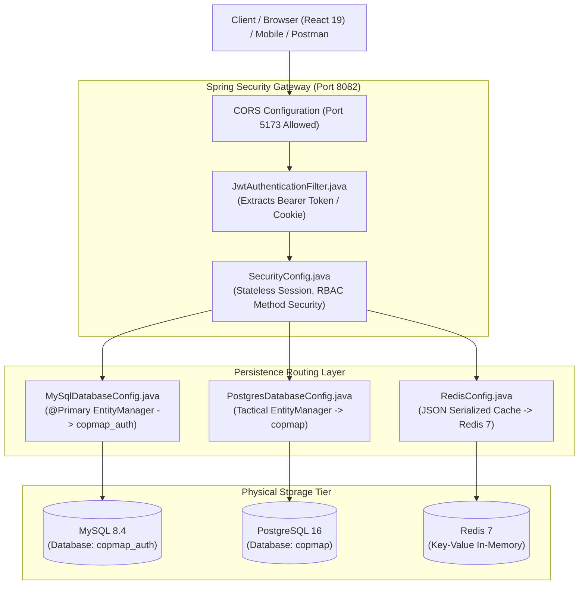
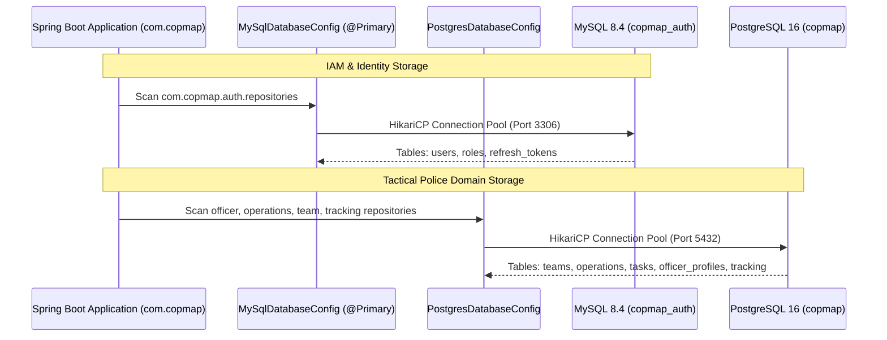
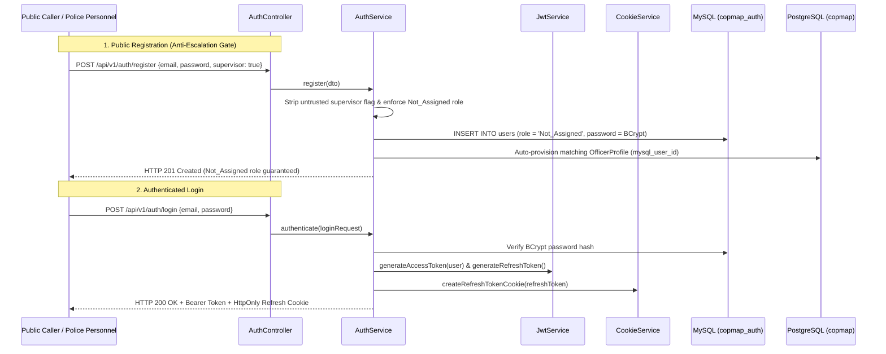
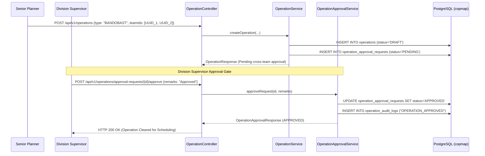
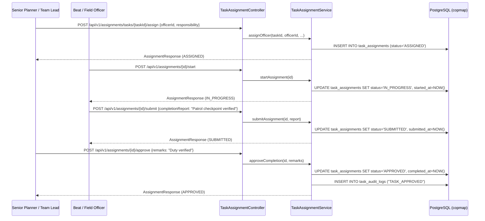
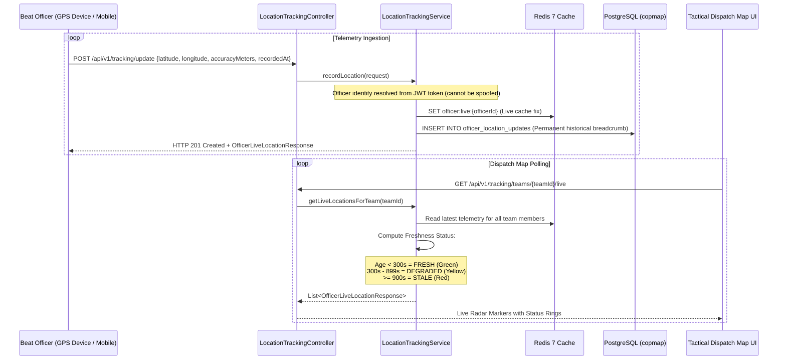
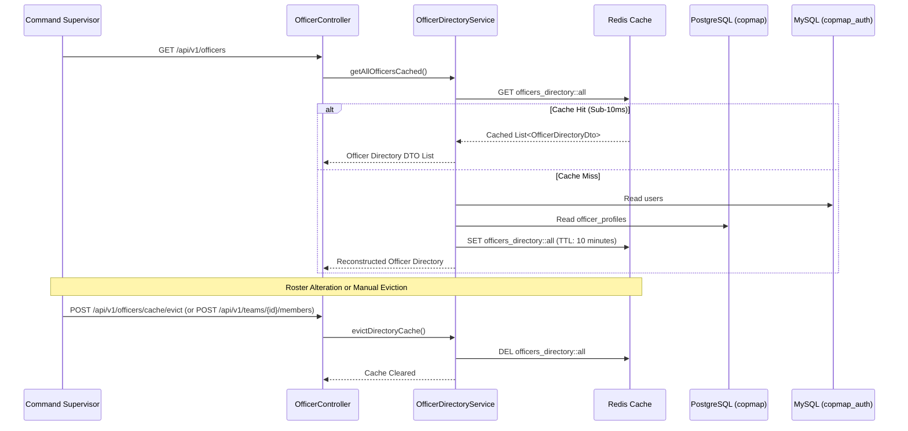

# CopMap (CMP) — Tactical Police Command & Operations Platform

> **Official Law Enforcement Operations System**  
> A mission-critical command, control, and coordination platform for police departments. Designed for real-time GPS telemetry tracking with signal freshness evaluation, automated Bandobast, Patrolling, and Nakabandi perimeter management, strict 5-tier chain-of-command workflows, Redis-cached officer directory search, dual-database physical isolation (MySQL + PostgreSQL), and court-admissible tactical PDF dossier generation.

---

## Table of Contents

1. [Executive Summary & System Architecture](#1-executive-summary--system-architecture)
2. [End-to-End System Flows (Mermaid Diagrams)](#2-end-to-end-system-flows)
   - [2.1 High-Level Architecture & Request Flow](#21-high-level-architecture--request-flow)
   - [2.2 Dual-Database Isolation & JPA Routing Flow](#22-dual-database-isolation--jpa-routing-flow)
   - [2.3 Security, JWT Authentication & Privilege Escalation Protection](#23-security-jwt-authentication--privilege-escalation-protection)
   - [2.4 Tactical Operation & Cross-Team Approval Workflow](#24-tactical-operation--cross-team-approval-workflow)
   - [2.5 Tactical Task & Duty Lifecycle Flow](#25-tactical-task--duty-lifecycle-flow)
   - [2.6 Real-Time GPS Telemetry & Signal Freshness Flow](#26-real-time-gps-telemetry--signal-freshness-flow)
   - [2.7 Redis Officer Directory Caching & Invalidation Flow](#27-redis-officer-directory-caching--invalidation-flow)
3. [Folder Structure & Component Breakdown](#3-folder-structure--component-breakdown)
   - [3.1 Infrastructure & Database Configuration (`config/`)](#31-infrastructure--database-configuration-config)
   - [3.2 Identity, RBAC & Authentication (`auth/`)](#32-identity-rbac--authentication-auth)
   - [3.3 Tactical Teams & Rostering (`team/`)](#33-tactical-teams--rostering-team)
   - [3.4 Officer Profiles & Tactical Tasks (`officer/`)](#34-officer-profiles--tactical-tasks-officer)
   - [3.5 Tactical Operations & Approvals (`operations/common/`)](#35-tactical-operations--approvals-operationscommon)
   - [3.6 Real-Time GPS Telemetry (`tracking/`)](#36-real-time-gps-telemetry-tracking)
   - [3.7 Error Handling & Fault Envelope (`dtos/` & `exceptions/`)](#37-error-handling--fault-envelope-dtos--exceptions)
   - [3.8 Tactical Command Frontend (`frontend/`)](#38-tactical-command-frontend-frontend)
   - [3.9 Automated Postman & Newman Test Harness (`postman/`)](#39-automated-postman--newman-test-harness-postman)
4. [Chain of Command & Role Hierarchy](#4-chain-of-command--role-hierarchy)
5. [Court-Admissible Tactical PDF Dossier Engine](#5-court-admissible-tactical-pdf-dossier-engine)
6. [Complete REST API Reference](#6-complete-rest-api-reference)
7. [Installation & Run Setup Guide](#7-installation--run-setup-guide)
   - [7.1 Fast-Track Quickstart (Full Docker Stack)](#71-fast-track-quickstart-full-docker-stack)
   - [7.2 System Prerequisites](#72-system-prerequisites)
   - [7.3 Step 1: Environment Configuration (`.env`)](#73-step-1-environment-configuration-env)
   - [7.4 Step 2: Database & Cache Provisioning (Docker Compose)](#74-step-2-database--cache-provisioning-docker-compose)
   - [7.5 Step 3: Backend Setup & Execution (Port 8082)](#75-step-3-backend-setup--execution-port-8082)
   - [7.6 Step 4: Frontend Setup & Execution (Port 5173)](#76-step-4-frontend-setup--execution-port-5173)
   - [7.7 Step 5: Verification & Testing (155 Unit/Integration/Chaos Tests + Newman)](#77-step-5-verification--testing-155-unitintegrationchaos-tests--newman)

---

## 1. Executive Summary & System Architecture

Modern law enforcement deployments require instantaneous tactical clarity, tamper-evident record keeping, and sub-second coordination between central control rooms, field commanders, and beat officers on the ground.

```
                           ┌──────────────────────────────────────────────┐
                           │          Tactical Frontend Client            │
                           │   React 19 + TypeScript + Vite + Tailwind    │
                           │  Interactive Radar + Leaflet Map + jsPDF     │
                           └──────────────────────┬───────────────────────┘
                                                  │ REST / JSON (JWT Bearer & Cookie)
                                                  ▼
                           ┌──────────────────────────────────────────────┐
                           │          Spring Boot 3.5.7 Backend           │
                           │    Spring Security + Dual JPA + Redis Cache  │
                           │              Package: com.copmap             │
                           └──────────────┬───────────────┬───────────────┘
                                          │               │
                 ┌────────────────────────┴────────┐      │
                 ▼                                 ▼      ▼
    ┌─────────────────────────┐     ┌────────────────────────┐     ┌────────────────────────┐
    │ MySQL 8.4 (copmap_auth) │     │ PostgreSQL 16 (copmap) │     │      Redis 7.x Cache   │
    │  - User Accounts        │     │  - Tactical Teams      │     │  - Officer Directory   │
    │  - BCrypt Password Hashes│    │  - Team Memberships    │     │  - Live Officer Telemetry│
    │  - JWT Refresh Tokens   │     │  - Tactical Operations │     │  - <10ms Query Latency │
    │  - Roles (UUID)         │     │  - Checkpoint Zones    │     │  - 10m TTL / Eviction  │
    │                         │     │  - Dispatched Tasks    │     │                        │
    │                         │     │  - GPS Breadcrumbs     │     │                        │
    │                         │     │  - Immutable Audit Logs│     │                        │
    └─────────────────────────┘     └────────────────────────┘     └────────────────────────┘
```

### Core Architectural Pillars
- **Dual-Database Physical Isolation**: Identity credentials (passwords, JWT tokens, account statuses) reside strictly in MySQL (`copmap_auth`). High-volume law enforcement domain data (teams, operations, geofenced checkpoints, task dispatches, and GPS breadcrumbs) reside in PostgreSQL (`copmap`). Both databases use UUID identifiers to prevent enumeration attacks.
- **Distributed In-Memory Telemetry & Caching**: Redis 7 powers sub-10ms officer directory lookups (`officers_directory::all`) and caches the latest live GPS telemetry fixes (`officer:live:{officerId}`) for real-time map rendering.
- **Evidence-Grade Immutability**: All tactical events, team modifications, assignment completions, and operation reviews generate append-only audit logs via Hibernate `@Immutable` entities. Checkpoints and locations with associated operational assignments are protected from deletion (`409 Conflict`).
- **Role Escalation Protection**: Public self-registration assigns the default `Not_Assigned` role and automatically strips the `supervisor` flag. Elevated roles (`Supervisor`, `Administrator`) can only be provisioned by authenticated command supervisors.
- **Instant Client-Side Dossier Compilation**: Zero-server-overhead PDF generation compiles classified operational summaries (`CONFIDENTIAL // LAW ENFORCEMENT SENSITIVE`) for Division Supervisors, Senior Planners, Team Leads, Control Operators, and Beat Officers.

---

## 2. End-to-End System Flows

### 2.1 High-Level Architecture & Request Flow



---

### 2.2 Dual-Database Isolation & JPA Routing Flow



---

### 2.3 Security, JWT Authentication & Privilege Escalation Protection



---

### 2.4 Tactical Operation & Cross-Team Approval Workflow



---

### 2.5 Tactical Task & Duty Lifecycle Flow



---

### 2.6 Real-Time GPS Telemetry & Signal Freshness Flow



---

### 2.7 Redis Officer Directory Caching & Invalidation Flow



---

## 3. Folder Structure & Component Breakdown

### 3.1 Infrastructure & Database Configuration (`config/`)

Manages dual JPA routing, distributed cache serialization, and OpenAPI specs.

- **Files**:
  - `MySqlDatabaseConfig.java`: Configures primary MySQL `DataSource` (`spring.datasource`), builds `mysqlEntityManagerFactory` scanning package `com.copmap.auth.entities`, and registers `@Primary PlatformTransactionManager`.
  - `PostgresDatabaseConfig.java`: Configures secondary PostgreSQL `DataSource` (`app.datasource.postgres`), builds `postgresEntityManagerFactory` scanning packages `officer`, `operations`, `team`, and `tracking`, and registers `postgresTransactionManager`.
  - `RedisConfig.java`: Provisions `RedisTemplate<String, Object>` with polymorphic Jackson serialization (`GenericJackson2JsonRedisSerializer`) and 10-minute caching default.
  - `APIDocConfig.java`: Configures OpenAPI 3.0 documentation with JWT Bearer security scheme.
  - `ProjectConfig.java`: Exposes utility beans (`ModelMapper`).
- **Data Flow**:
  - Controller $\rightarrow$ Service $\rightarrow$ Designated Repository $\rightarrow$ Target `EntityManagerFactory` $\rightarrow$ HikariCP Pool $\rightarrow$ MySQL / PostgreSQL.

---

### 3.2 Identity, RBAC & Authentication (`auth/`)

Manages credentials, user roles, password encryption, and token lifecycles.

- **Key Files**:
  - `User.java`: MySQL entity (`users`) with UUID primary key and `policePost`.
  - `Role.java`: MySQL entity (`roles`) with UUID primary key (`Supervisor`, `Administrator`, `Not_Assigned`, etc.).
  - `RefreshToken.java`: MySQL entity (`refresh_tokens`).
  - `SecurityConfig.java`: Stateless session configuration, CORS filters, and security rules.
  - `JwtAuthenticationFilter.java`: Intercepts inbound HTTP requests and binds `SecurityContextHolder`.
  - `AuthController.java`: Login, register, refresh, logout, and profile endpoints.
  - `UserController.java`: RBAC-protected administrative user management endpoints (`hasAnyAuthority('Supervisor', 'Administrator')`).
- **Privilege Gate**:
  - Public registration strips the `supervisor` flag and assigns `Not_Assigned`. Elevated roles can only be granted by authenticated Supervisors/Admins via `UserController`.

---

### 3.3 Tactical Teams & Rostering (`team/`)

Manages specialized law enforcement units, member assignments, and audit trails.

- **Key Files**:
  - `Team.java`: PostgreSQL entity (`teams`) with UUID primary key and unique team name.
  - `TeamMembership.java`: Junction entity (`team_memberships`) linking teams to `OfficerProfile`.
  - `TeamAuditLog.java`: Append-only, Hibernate `@Immutable` audit log entity (`team_audit_logs`).
  - `TeamRole.java`: Enum representing the 5 tactical roles:
    - `SENIOR_PLANNER`: Plans operations, creates tasks, schedules manpower.
    - `TEAM_LEAD`: Directs ground operations and assigns officers to tasks.
    - `CONTROL_OPERATOR`: Monitors live 24/7 map telemetry and freshness.
    - `ADMINISTRATOR`: Administrative configuration and team management.
    - `FIELD_OPERATOR`: Beat officer executing field duties.
  - `TeamController.java`, `TeamService.java`, `TeamAuthorizationService.java`.

---

### 3.4 Officer Profiles & Tactical Tasks (`officer/`)

Manages officer records, Redis directory caching, task creation, and duty workflows.

- **Key Files**:
  - `OfficerProfile.java`: PostgreSQL entity (`officer_profiles`) linked to MySQL user by `mysqlUserId`.
  - `Task.java`: PostgreSQL entity (`tasks`) with priority, coordinates, description, and status.
  - `TaskAssignment.java`: PostgreSQL entity (`task_assignments`) with statuses: `ASSIGNED`, `IN_PROGRESS`, `SUBMITTED`, `APPROVED`, `REJECTED`, `REASSIGNED`.
  - `TaskAuditLog.java`: PostgreSQL entity (`task_audit_logs`).
  - `OfficerController.java`: Role-gated officer roster and cache eviction endpoints.
  - `TaskController.java`: Task dispatch and listing endpoints (`/api/v1/tasks`).
  - `TaskAssignmentController.java`: Duty execution and review endpoints (`/api/v1/assignments`).

---

### 3.5 Tactical Operations & Approvals (`operations/common/`)

Manages high-priority joint operations, checkpoint perimeters, and multi-tier supervisor approvals.

- **Key Files**:
  - `Operation.java`: PostgreSQL entity (`operations`) with UUID primary key.
  - `OperationType.java`: Enum (`BANDOBAST`, `PATROLLING`, `NAKABANDI`).
  - `OperationStatus.java`: Enum (`DRAFT`, `PLANNED`, `ACTIVE`, `PAUSED`, `COMPLETED`, `CANCELLED`).
  - `OperationLocation.java`: Checkpoint zones with latitude, longitude, and geofence radius.
  - `OperationApprovalRequest.java`: Cross-team authorization tracking (`PENDING`, `APPROVED`, `REJECTED`).
  - `OperationAuditLog.java`: Append-only audit history for operations.
  - `OperationController.java`: Operation CRUD and approval review endpoints.
  - `OperationLocationController.java`: Checkpoint creation and deletion with `409 Conflict` audit protection.
  - `OperationAssignmentController.java`: Officer checkpoint assignment and lifecycle endpoints.

---

### 3.6 Real-Time GPS Telemetry (`tracking/`)

High-frequency GPS ingestion, live Redis caching, and signal freshness evaluation.

- **Key Files**:
  - `OfficerLocationUpdate.java`: PostgreSQL historical breadcrumb entity (`officer_location_updates`).
  - `LocationUpdateRequest.java`: Inbound payload (`latitude`, `longitude`, `accuracyMeters`, `recordedAt`).
  - `OfficerLiveLocationResponse.java`: Live telemetry payload with evaluated `freshnessStatus`.
  - `LocationTrackingController.java`: Endpoints `/api/v1/tracking/update` and `/api/v1/tracking/teams/{teamId}/live`.
  - `LocationTrackingService.java`: Evaluates signal freshness against current server clock:
    - **FRESH**: Age $< 300\text{ seconds}$ (Green status indicator).
    - **DEGRADED**: Age $300\text{s} - 899\text{ seconds}$ (Yellow status indicator).
    - **STALE**: Age $\ge 900\text{ seconds}$ (Red status indicator).

---

### 3.7 Error Handling & Fault Envelope (`dtos/` & `exceptions/`)

- **Files**:
  - `ApiError.java`: Standardized record payload (`status`, `error`, `message`, `path`, `timestamp`, `validationErrors`).
  - `GlobalExceptionHandler.java`: Intercepts exceptions and returns standardized JSON envelopes without leaking credentials or internal stack traces.

---

### 3.8 Tactical Command Frontend (`frontend/`)

Client-side Single Page Application built with React 19, TypeScript, Vite, and Tailwind CSS.

- **Key Source Files**:
  - `src/components/map/TacticalMapView.tsx`: Leaflet map rendering live officers, freshness status rings, and checkpoints.
  - `src/components/map/OfficerMapModal.tsx`: Inspection modal for individual officer live telemetry and history.
  - `src/services/pdfReportService.ts`: Client-side vector PDF compilation using `jspdf` and `jspdf-autotable`.
  - `src/pages/teams/TeamsDashboard.tsx`: Command dashboard listing tactical teams, active operations, and personnel.
  - `src/pages/teams/TeamDetailView.tsx`: Deep command center managing roster additions, task dispatches, map radar, and audit history.
  - `src/auth/store.ts`: Zustand store managing JWT authentication, user profile, and session persistence.
  - `src/config/apiClient.ts`: Axios client with automated cookie and bearer token interceptors.

---

### 3.9 Automated Postman & Newman Test Harness (`postman/`)

- `CopMap_API_Tests.postman_collection.json`: 45 automated API requests covering all 8 operational domains with 82 assertions.
- `CopMap_Live_Demo.postman_collection.json`: Interactive demo collection with concrete IDs and 45 embedded real responses.
- `CopMap_Local.postman_environment.json`: Local QA environment configuration (`baseUrl: http://localhost:8082`).

---

## 4. Chain of Command & Role Hierarchy

| Role | Insignia / Authority | Core Responsibilities | Dossier Access Scope |
| :--- | :--- | :--- | :--- |
| **Supervisor** | Division Command | Approves joint operations, provisions supervisor accounts, reviews audit trails. | Full access to all unit dossiers, officer service dossiers, and audit trails. |
| **Senior Planner** | Strategic Planning | Creates Bandobast/Nakabandi operations, schedules manpower quotas, dispatches tasks. | Unit operational dossiers and officer dossiers. |
| **Team Lead** | Field Commander | Assigns checkpoints, monitors live telemetry, reviews and endorses completion reports. | Unit operational dossiers and member service dossiers. |
| **Control Operator** | 24/7 Dispatch Desk | Monitors live tactical radar, tracks GPS signal freshness, coordinates emergencies. | Live unit telemetry and operational dossiers. |
| **Field Operator** | Beat Officer | Ingests GPS fixes, accepts assignments, starts duty, files completion reports. | Individual service dossiers and personal duty logs. |

---

## 5. Court-Admissible Tactical PDF Dossier Engine

CopMap features zero-server-overhead, client-side vector PDF compilation implemented in `frontend/src/services/pdfReportService.ts`.

### Dossier Formats
1. **Full Tactical Unit Dossier**:
   - Executive header with classification markings (`CONFIDENTIAL // LAW ENFORCEMENT SENSITIVE`).
   - Operation details, objectives, and geofenced checkpoint locations.
   - Tactical team roster, roles, and assigned radio callsigns.
   - Comprehensive task dispatch matrix with start and completion timestamps.
   - Command authorization block with digital verification signature seal.
2. **Individual Officer Service Dossier**:
   - Officer badge number, designation, and duty status.
   - Chronological duty log of assigned, submitted, and approved tasks.
   - Field incident reports, officer notes, and checkpoint verification logs.
   - Telemetry health snapshot and supervisor sign-off endorsement.

---

## 6. Complete REST API Reference

### Identity & Authentication (`/api/v1/auth`) — MySQL `copmap_auth`
| Method | Endpoint | Description | Access |
| :--- | :--- | :--- | :--- |
| `POST` | `/api/v1/auth/login` | Authenticate with email/password; returns JWT + Refresh Cookie | Public |
| `POST` | `/api/v1/auth/register` | Public registration (assigns `Not_Assigned` role; strips supervisor flag) | Public |
| `POST` | `/api/v1/auth/refresh` | Rotate and issue new access token using refresh token | Public |
| `POST` | `/api/v1/auth/logout` | Revoke session and clear cookies | Authenticated |
| `GET` | `/api/v1/auth/me` | Fetch authenticated user profile and roles | Authenticated |

### User Management (`/api/v1/users`) — MySQL `copmap_auth`
| Method | Endpoint | Description | Access |
| :--- | :--- | :--- | :--- |
| `POST` | `/api/v1/users` | Provision user account (can grant `Supervisor` role) | Supervisor / Admin |
| `GET` | `/api/v1/users` | List all user accounts | Supervisor / Admin |
| `GET` | `/api/v1/users/{userId}` | Get user details by UUID | Supervisor / Admin |
| `GET` | `/api/v1/users/email/{email}` | Look up user by email | Supervisor / Admin |
| `DELETE` | `/api/v1/users/{userId}` | Delete user account by UUID | Supervisor / Admin |

### Tactical Teams (`/api/v1/teams`) — PostgreSQL `copmap`
| Method | Endpoint | Description | Access |
| :--- | :--- | :--- | :--- |
| `POST` | `/api/v1/teams` | Create a tactical unit | Supervisor / Planner |
| `GET` | `/api/v1/teams` | List authorized teams for user | Authenticated |
| `GET` | `/api/v1/teams/{teamId}` | Get team details, member count, and active operations | Team Member |
| `GET` | `/api/v1/teams/{teamId}/members` | Get roster members and assigned team roles | Team Member |
| `POST` | `/api/v1/teams/{teamId}/members` | Add officer to unit roster (evicts directory cache) | Supervisor / Planner |
| `DELETE` | `/api/v1/teams/{teamId}/members/{officerId}` | Remove officer from unit (records audit log) | Supervisor / Planner |
| `GET` | `/api/v1/teams/{teamId}/audit` | View immutable team audit trail | Team Member |

### Officer Directory (`/api/v1/officers`) — Redis & PostgreSQL
| Method | Endpoint | Description | Access |
| :--- | :--- | :--- | :--- |
| `GET` | `/api/v1/officers` | Fetch division-wide Redis-cached officer directory | Supervisor / Admin |
| `GET` | `/api/v1/officers/available` | Scoped availability directory (`?teamId={uuid}`) | Authorized Team Role |
| `POST` | `/api/v1/officers/cache/evict` | Manually evict directory cache (`officers_directory::all`) | Supervisor / Admin |

### Tactical Operations (`/api/v1/operations`) — PostgreSQL `copmap`
| Method | Endpoint | Description | Access |
| :--- | :--- | :--- | :--- |
| `POST` | `/api/v1/operations` | Create Bandobast, Patrolling, or Nakabandi operation | Supervisor / Planner |
| `GET` | `/api/v1/operations` | List operations (filterable by `type` and `status`) | Authenticated |
| `GET` | `/api/v1/operations/{operationId}` | Get operation details, timeline, and checkpoints | Authenticated |
| `PUT` | `/api/v1/operations/{operationId}/schedule` | Set planned start and end timestamps | Supervisor / Planner |
| `PATCH` | `/api/v1/operations/{operationId}/status` | Update state (`ACTIVE`, `PAUSED`, `COMPLETED`, etc.) | Supervisor / Planner |
| `GET` | `/api/v1/operations/approval-requests` | List cross-team approval requests (`?status=PENDING`) | Supervisor |
| `POST` | `/api/v1/operations/approval-requests/{id}/approve` | Supervisor endorses cross-team operation | Supervisor |
| `POST` | `/api/v1/operations/approval-requests/{id}/reject` | Supervisor rejects cross-team operation | Supervisor |
| `POST` | `/api/v1/operations/{operationId}/locations` | Add geofenced checkpoint perimeter | Supervisor / Planner |
| `GET` | `/api/v1/operations/{operationId}/locations` | List checkpoints belonging to an operation | Authenticated |
| `GET` | `/api/v1/operations/locations/{locationId}` | Get single checkpoint details | Authenticated |
| `PUT` | `/api/v1/operations/locations/{locationId}` | Update checkpoint parameters | Supervisor / Planner |
| `DELETE` | `/api/v1/operations/locations/{locationId}` | Delete checkpoint (enforces 409 Conflict if assigned) | Supervisor / Planner |
| `GET` | `/api/v1/operations/{operationId}/audit-history` | View immutable operation audit logs | Authenticated |

### Operation Checkpoint Assignments (`/api/v1/operations`) — PostgreSQL `copmap`
| Method | Endpoint | Description | Access |
| :--- | :--- | :--- | :--- |
| `POST` | `/api/v1/operations/locations/{locationId}/assignments` | Assign officer to checkpoint | Supervisor / Planner |
| `GET` | `/api/v1/operations/my-assignments` | View authenticated officer's assignments | Authenticated Officer |
| `GET` | `/api/v1/operations/assignments/{assignmentId}` | Get assignment details by UUID | Assigned / Supervisor |
| `GET` | `/api/v1/operations/{operationId}/assignments` | List all assignments for an operation | Authenticated |
| `PATCH` | `/api/v1/operations/assignments/{id}/acknowledge` | Officer acknowledges assignment | Assigned Officer |
| `PATCH` | `/api/v1/operations/assignments/{id}/start` | Officer starts duty on site | Assigned Officer |
| `PATCH` | `/api/v1/operations/assignments/{id}/complete` | Officer submits completion report | Assigned Officer |
| `PATCH` | `/api/v1/operations/assignments/{id}/cancel` | Supervisor cancels assignment | Supervisor / Admin |

### Tactical Tasks (`/api/v1/tasks`) — PostgreSQL `copmap`
| Method | Endpoint | Description | Access |
| :--- | :--- | :--- | :--- |
| `POST` | `/api/v1/tasks` | Dispatch new task with orders and location | Lead / Planner |
| `GET` | `/api/v1/tasks` | List authorized tasks (`?teamId={uuid}`) | Authenticated |
| `GET` | `/api/v1/tasks/{taskId}` | Get task details by UUID | Authenticated |

### Task Assignments (`/api/v1/assignments`) — PostgreSQL `copmap`
| Method | Endpoint | Description | Access |
| :--- | :--- | :--- | :--- |
| `POST` | `/api/v1/assignments/tasks/{taskId}/assign` | Assign officer to task | Lead / Planner |
| `GET` | `/api/v1/assignments/tasks/{taskId}` | List assignments for task | Authenticated |
| `GET` | `/api/v1/assignments/my-assignments` | List logged-in officer's tasks | Authenticated Officer |
| `POST` | `/api/v1/assignments/{id}/reassign` | Reassign task to different officer | Lead / Planner |
| `POST` | `/api/v1/assignments/{id}/start` | Officer marks arrival and starts duty | Assigned Officer |
| `POST` | `/api/v1/assignments/{id}/submit` | Officer submits field completion report | Assigned Officer |
| `POST` | `/api/v1/assignments/{id}/approve` | Lead / Supervisor endorses task completion | Lead / Supervisor |
| `POST` | `/api/v1/assignments/{id}/reject` | Lead / Supervisor rejects completion report | Lead / Supervisor |

### Real-Time GPS Tracking (`/api/v1/tracking`) — Redis & PostgreSQL
| Method | Endpoint | Description | Access |
| :--- | :--- | :--- | :--- |
| `POST` | `/api/v1/tracking/update` | Ingest GPS fix (updates Redis fix + PostgreSQL history) | Authenticated Officer |
| `GET` | `/api/v1/tracking/teams/{teamId}/live` | Get live radar telemetry with freshness evaluation | Team Member |
| `GET` | `/api/v1/tracking/officers/{officerId}/latest` | Fetch latest live telemetry fix for single officer | Team Member |

---

## 7. Installation & Run Setup Guide

Follow this guide to run the entire CopMap platform from a fresh git clone on Windows, macOS, or Linux.

### 7.1 Fast-Track Quickstart (Full Docker Stack)

If you have Docker & Docker Compose installed, you can clone and launch the entire platform (Databases, Redis, Spring Boot Backend API, and React Frontend) with four commands:

```bash
git clone https://github.com/Anantctrl/CMP.git
cd CMP
cp .env.example .env
docker compose pull
docker compose up -d --build
```
> **Endpoints**:
> - **Frontend Web UI**: `http://localhost:3000`
> - **Backend API**: `http://localhost:8082`
> - **OpenAPI 3.1 Documentation**: `http://localhost:8082/swagger-ui/index.html`

---

### 7.2 System Prerequisites (For Local / Native Execution)
- **Java**: OpenJDK 21 or higher (`java -version`)
- **Node.js**: v20.x or higher with `npm` (`node -v`)
- **Docker & Docker Compose** (Required for databases & cache)

---

### 7.3 Step 1: Environment Configuration (`.env`)

> [!IMPORTANT]
> Always initialize `.env` before running Docker Compose or local services. Compose parses the root `.env` during startup.

In the repository root, create `.env` from the template:

```bash
# macOS / Linux
cp .env.example .env

# Windows PowerShell
Copy-Item .env.example .env
```

The default values in `.env` are pre-configured for local development (`qa` profile):
```env
# Database Credentials
MYSQL_ROOT_PASSWORD=mysql
MYSQL_USER=root
MYSQL_PASSWORD=mysql
POSTGRES_USER=copmap_app
POSTGRES_PASSWORD=localdev123

# Security & JWT
JWT_SECRET=ekqSbKMKgO507t7QvNUz7tXRmlv/eo0YZUkwpFXYKkcsIgJ2e0VsVeelnzX+oUho
JWT_ISSUER=api.copmap.gov

# Tactical Frontend
FRONT_END_URL=http://localhost:5173,http://localhost:3000
DEV_SEED_PASSWORD=Password@123
```

---

### 7.4 Step 2: Database & Cache Provisioning (Docker Compose)

From the repository root, pull dependencies and launch the three data stores in detached mode:
```bash
docker compose pull
docker compose up -d mysql postgres redis
```
This provisions:
- `copmap-mysql` on host port **`127.0.0.1:3306`** with database `copmap_auth` (initialized via `compose/mysql/init/01-copmap.sql`)
- `copmap-postgres` on host port **`127.0.0.1:5432`** with database `copmap` (user `copmap_app`)
- `copmap-redis` on host port **`127.0.0.1:6379`** for directory and live telemetry caching

> [!NOTE]
> **Host Port Conflicts**: If you already have a native MySQL instance running on host port 3306, you can either stop the local service (`net stop MySQL80` on Windows, or `sudo systemctl stop mysql` on Linux) or map Compose to port 3307 in `compose.yaml` (`"127.0.0.1:3307:3306"`) and set `MYSQL_URL=jdbc:mysql://localhost:3307/copmap_auth` in your backend shell.

---

### 7.5 Step 3: Backend Setup & Execution (Port 8082)

Spring Boot reads environment variables from the OS/shell environment (it does not parse `.env` files directly).

1. Navigate to the backend directory:
   ```bash
   cd backend
   ```

2. Compile the backend:
   ```bash
   # Windows PowerShell / CMD
   .\mvnw.cmd clean compile

   # macOS / Linux
   ./mvnw clean compile
   ```

3. Launch the Spring Boot application:

   - **Windows PowerShell**:
     ```powershell
     $env:SPRING_PROFILES_ACTIVE = "qa"
     $env:JWT_SECRET = "ekqSbKMKgO507t7QvNUz7tXRmlv/eo0YZUkwpFXYKkcsIgJ2e0VsVeelnzX+oUho"
     .\mvnw.cmd spring-boot:run
     ```
     *(Or import all `.env` values directly into your PowerShell session)*:
     ```powershell
     Get-Content ..\.env | ForEach-Object { if ($_ -match '^([^#=]+)=(.*)$') { [System.Environment]::SetEnvironmentVariable($matches[1].Trim(), $matches[2].Trim(), 'Process') } }
     .\mvnw.cmd spring-boot:run
     ```

   - **macOS / Linux**:
     ```bash
     export SPRING_PROFILES_ACTIVE=qa
     export JWT_SECRET="ekqSbKMKgO507t7QvNUz7tXRmlv/eo0YZUkwpFXYKkcsIgJ2e0VsVeelnzX+oUho"
     ./mvnw spring-boot:run
     ```
     *(Or export all `.env` values directly)*:
     ```bash
     export $(grep -v '^#' ../.env | xargs)
     ./mvnw spring-boot:run
     ```

   *The backend defaults to active profile `qa` (`application.yml`), automatically connects to MySQL (`localhost:3306/copmap_auth`), PostgreSQL (`localhost:5432/copmap`), and Redis (`localhost:6379`), initializes schema tables (`ddl-auto: update`), and listens on **`http://localhost:8082`**.*

4. Verify backend health and documentation:
   - OpenAPI UI: **`http://localhost:8082/swagger-ui/index.html`**
   - Raw OpenAPI Specs: **`http://localhost:8082/v3/api-docs`**

---

### 7.6 Step 4: Frontend Setup & Execution (Port 5173)

1. In a new terminal, navigate to the frontend directory:
   ```bash
   cd frontend
   ```

2. Install dependencies:
   ```bash
   npm install
   ```

3. Launch the Vite development server:
   ```bash
   npm run dev
   ```

4. Access the tactical command interface in your browser:
   - **`http://localhost:5173`**
   - Login with pre-seeded credentials or register a new officer account.

---

### 7.7 Step 5: Verification & Testing (155 Unit/Integration/Chaos Tests + Newman)

#### 1. Execute Full Java Automated Test Suite (155 Tests)
Run the entire suite of unit, integration, multi-database routing, and chaos stress tests:
```bash
cd backend

# Windows PowerShell / CMD
.\mvnw.cmd test

# macOS / Linux
./mvnw test
```
**Expected Verified Result:**
```
[INFO] Results:
[INFO] 
[INFO] Tests run: 155, Failures: 0, Errors: 0, Skipped: 0
[INFO] 
[INFO] ------------------------------------------------------------------------
[INFO] BUILD SUCCESS
[INFO] ------------------------------------------------------------------------
```

#### 2. Execute Headless Newman API Suite (45 Requests / 82 Assertions)
With the backend running on port 8082, execute Newman against the automated API suite:
```bash
cd postman
npx newman run CopMap_API_Tests.postman_collection.json \
  -e CopMap_Local.postman_environment.json \
  --reporters cli
```
**Expected Result:**
```
┌─────────────────────────┬─────────────────────┬─────────────────────┐
│ Category                │ Executed            │ Failed              │
├─────────────────────────┼─────────────────────┼─────────────────────┤
│ Total Requests          │ 45                  │ 0                   │
│ Total Assertions        │ 82                  │ 0                   │
│ Success Rate            │ 100%                │ 0%                  │
└─────────────────────────┴─────────────────────┴─────────────────────┘
```

#### 3. Interactive Postman Live Demo Collection
For manual testing and endpoint exploration, import [`CopMap_Live_Demo.postman_collection.json`](./postman/CopMap_Live_Demo.postman_collection.json) into Postman. It contains pre-configured requests with realistic UUIDs and 45 real saved response examples.

---

*CopMap Tactical Command System &bull; Official Law Enforcement Operations Platform &bull; All Rights Reserved.*
