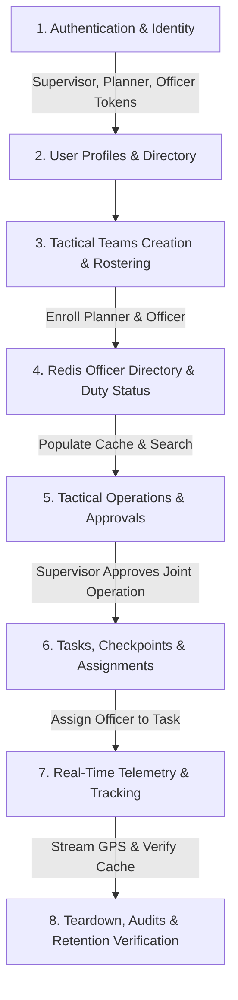

# CopMap Tactical Police API - Postman Test Suite & Newman Execution

This directory contains the automated end-to-end API test suite for the **CopMap Tactical Police Command & Real-Time Tracking Platform**.

---

## 📁 Directory Files

| File | Type | Description |
|---|---|---|
| [`CopMap_API_Tests.postman_collection.json`](file:///D:/Project/cmp/postman/CopMap_API_Tests.postman_collection.json) | Postman Collection (v2.1) | 45 comprehensive API requests spanning 8 functional modules with dynamic chained assertions. |
| [`CopMap_Local.postman_environment.json`](file:///D:/Project/cmp/postman/CopMap_Local.postman_environment.json) | Postman Environment | Configuration environment targeting `http://localhost:8082` with dynamic tokens and entity IDs. |
| [`test-run-output.txt`](file:///D:/Project/cmp/postman/test-run-output.txt) | Raw Execution Log | Full console output from Newman executing all 45 requests against the live Spring Boot server. |
| [`test-run-report.json`](file:///D:/Project/cmp/postman/test-run-report.json) | Machine-Readable Report | Detailed JSON export of Newman execution results including response headers, timings, and assertions. |

---

## 🎯 Test Suite Architecture & Flow

The collection tests the complete operational lifecycle of a law-enforcement operation across PostgreSQL, MySQL, and Redis:



### Module Breakdown (45 Requests Total)

1. **Authentication & Identity (6 Requests)**
   - Registration and login for 3 distinct roles: `SUPERVISOR`, `SENIOR_PLANNER`, and field `OFFICER`.
   - Dynamic extraction and saving of Bearer JWT tokens (`supervisorToken`, `plannerToken`, `officerToken`) and user UUIDs.

2. **User Profiles & Directory (3 Requests)**
   - Supervisor authority checks (`GET /api/v1/users`).
   - Profile queries by email and user ID.

3. **Tactical Teams Creation & Rostering (5 Requests)**
   - Supervisor-authorized team creation: Primary Unit (*Alpha QRT*) and Secondary Unit (*Bravo Perimeter*).
   - Team membership assignments: Enrolling Senior Planner and Field Officer with assigned tactical roles (`SENIOR_PLANNER`, `OFFICER`).
   - Querying team details and membership rosters.

4. **Redis Officer Directory & Duty Status (4 Requests)**
   - Directory query (`GET /api/v1/officers`) verifying synchronous MySQL-to-Redis sync.
   - Searching officers by name and rank.
   - Duty status transitions (`ACTIVE`, `ON_DUTY`) and duty history queries.

5. **Tactical Operations & Approvals (11 Requests)**
   - Operation creation with primary and participating teams (`BANDOBAST`, `NAKABANDI`, `PATROLLING`).
   - Geo-fencing & tactical checkpoint creation.
   - **Cross-Team Approval Workflow**: Validating that multi-team operations generate pending approvals, requiring supervisor sign-off (`POST /api/v1/operations/approval-requests/{id}/approve`) before scheduling is permitted.
   - Scheduling (`PUT /api/v1/operations/{id}/schedule`) and activating (`PUT /api/v1/operations/{id}/activate`) operations.

6. **Tasks, Checkpoints & Assignments (10 Requests)**
   - Operation-bound task creation with priority levels (`HIGH`, `URGENT`, `CRITICAL`).
   - Assigning field officers to tasks and updating task states (`IN_PROGRESS`, `COMPLETED`).
   - Task comments and activity trail.

7. **Real-Time Telemetry & Tracking (3 Requests)**
   - High-frequency GPS telemetry ingestion (`POST /api/v1/tracking/locations`) with latitude, longitude, heading, speed, and accuracy.
   - Officer location trail retrieval (`GET /api/v1/tracking/officers/{id}/trail`) ensuring chronological sorting.
   - Latest location caching validation (`GET /api/v1/tracking/officers/{id}/latest`).

8. **Teardown, Audits & Retention Enforcement (3 Requests)**
   - **Audit Retention Rule Validation**: Attempting to delete a location with audit history (`DELETE /api/v1/operations/locations/{id}`) correctly asserts `409 Conflict` to guarantee law-enforcement audit integrity.
   - Officer team departure with operational remarks.
   - Officer session logout (`POST /api/v1/auth/logout`).

---

## 🚀 Execution Instructions

### Option 1: Run via Newman CLI (Recommended for CI/CD & Local Terminal)

From the project root:

```bash
npx newman run postman/CopMap_API_Tests.postman_collection.json \
  -e postman/CopMap_Local.postman_environment.json \
  --reporters cli,json \
  --reporter-json-export postman/test-run-report.json
```

Or save the console output directly to a file:

```powershell
npx newman run postman/CopMap_API_Tests.postman_collection.json -e postman/CopMap_Local.postman_environment.json | Tee-Object -FilePath postman/test-run-output.txt
```

### Option 2: Run via Postman Desktop

1. Open **Postman Desktop**.
2. Click **Import** in the upper left.
3. Select both `CopMap_API_Tests.postman_collection.json` and `CopMap_Local.postman_environment.json`.
4. In the environment dropdown in the top-right corner, select **CopMap Local**.
5. Click the collection name **CopMap Tactical Police API - Full End-to-End Test Suite** and click **Run Collection**.
6. Click **Run CopMap Tactical Police API**.

---

## 📊 Latest Live Execution Metrics

```text
┌─────────────────────────┬───────────────────┬───────────────────┐
│                         │          executed │            failed │
├─────────────────────────┼───────────────────┼───────────────────┤
│              iterations │                 1 │                 0 │
├─────────────────────────┼───────────────────┼───────────────────┤
│                requests │                45 │                 0 │
├─────────────────────────┼───────────────────┼───────────────────┤
│            test-scripts │                45 │                 0 │
├─────────────────────────┼───────────────────┼───────────────────┤
│      prerequest-scripts │                 0 │                 0 │
├─────────────────────────┼───────────────────┼───────────────────┤
│              assertions │                82 │                 0 │
├─────────────────────────┴───────────────────┴───────────────────┤
│ total run duration: 6.8s                                        │
├─────────────────────────────────────────────────────────────────┤
│ total data received: 37.78kB (approx)                           │
├─────────────────────────────────────────────────────────────────┤
│ average response time: 75ms [min: 18ms, max: 590ms, s.d.: 91ms] │
└─────────────────────────────────────────────────────────────────┘
```

- **Total Requests Executed:** 45
- **Total Assertions Passed:** 82 / 82 (100% Pass Rate)
- **Failed Assertions:** 0
- **Total Execution Time:** 6.8 seconds
- **Average API Latency:** 75 ms
